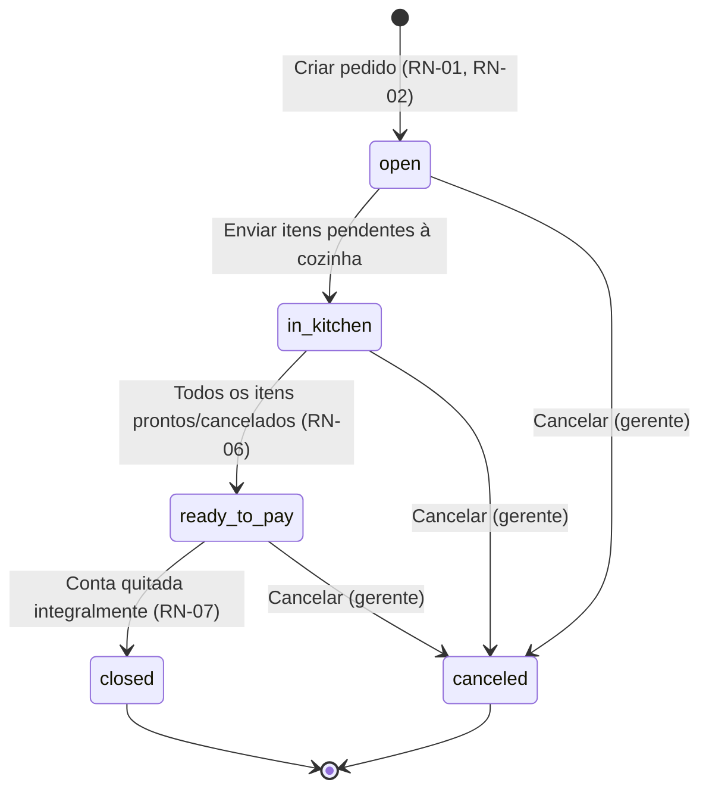
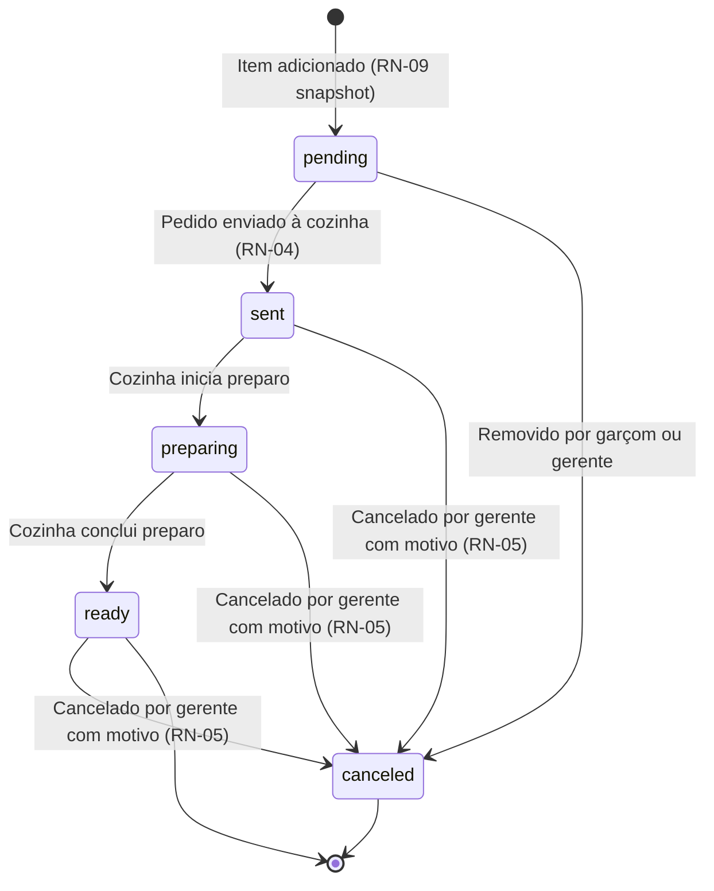
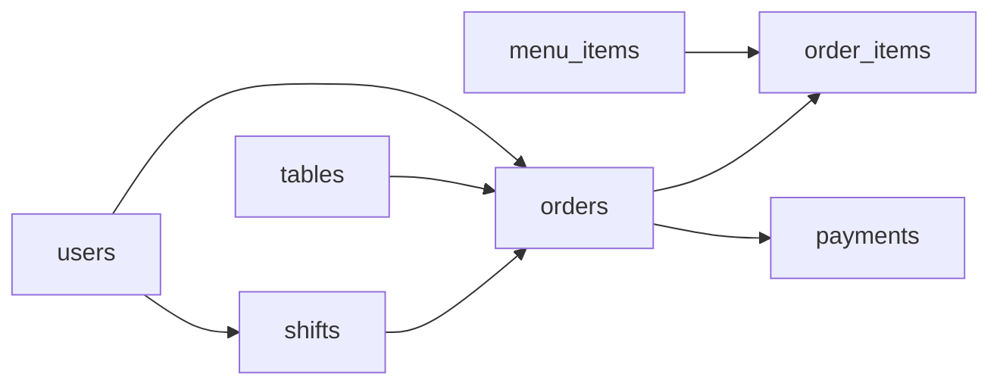

# 🏗️ Arquitetura, Máquinas de Estado e Ambiente — MesaFácil

Documentação técnica da modelagem de estados, entidades relacionais e configurações complementares de execução do **MesaFácil**.

---

## ⚙️ 1. Máquinas de Estado

### 1.1 Ciclo de Vida do Pedido (`orders.status`)

### 1.2 Ciclo de Vida do Item (`order_items.status`)

---

## 🗄️ 2. Modelo Relacional e Camadas

### Entidades no PostgreSQL (`sql/migrations/001..007`)

- **`users` (`001`):** credenciais (`password_hash` com `bcrypt`) e restrição de papel (`waiter`, `kitchen`, `cashier`, `manager`).
- **`shifts` (`002`):** controle de turno com índice único parcial (`shifts_single_open_idx`) garantindo no máximo um turno aberto por vez.
- **`tables` (`003`):** cadastro de mesas do salão (`available` / `occupied`).
- **`menu_items` (`004`):** itens do cardápio com preço em `DECIMAL(10,2)` e flag `available`.
- **`orders` (`005`):** comandas vinculadas a mesa, turno e usuário, protegidas pelo índice único parcial `orders_single_active_per_table_idx`.
- **`order_items` (`006`):** itens lançados com `unit_price` congelado e constraint `order_items_cancellation_reason_check`.
- **`payments` (`007`):** registros de pagamento por comanda (`cash`, `card`, `pix`) com `CHECK (amount > 0)`.

### Organização do Backend (`backend/src/`)

- **`database/DatabaseConnection.js`:** gerenciamento de pool único (`pg.Pool`) e execução transacional (`withTransaction` com `BEGIN` / `COMMIT` / `ROLLBACK`).
- **`repositories/`:** consultas SQL parametrizadas e bloqueio pessimista (`SELECT ... FOR UPDATE`) para serializar operações concorrentes sobre o mesmo pedido.
- **`services/`:** regras de negócio (`AuthService`, `OrderService`) desacopladas do transporte HTTP.
- **`errors/` e `middlewares/`:** hierarquia `AppError` (`400`, `401`, `403`, `404`, `409`, `422`), tradução determinística de erros do PostgreSQL (`pgErrors.js`) e controle de autenticação/RBAC (`authMiddleware.js`).

---

## 🐳 3. Notas Complementares de Ambiente

### Portas e Variáveis Opcionais no Docker Compose
- As portas expostas no host podem ser customizadas no `.env` por meio de `DB_PORT` (padrão `5432`), `BACKEND_PORT` (padrão `3001`) e `FRONTEND_PORT` (padrão `5173`).
- `backend/` e `frontend/` são montados como volume para *hot reload*. Quando houver alteração em dependências (`package.json`), reinicie os containers com `docker compose restart backend frontend`.

### Execução com DevContainer (`.devcontainer/`)
- Não execute o `docker-compose.yml` da raiz simultaneamente ao DevContainer caso ambos utilizem a porta `5432`.
- Dentro do DevContainer, utilize o host `db` na variável `DATABASE_URL` (`postgresql://mesafacil:mesafacil@db:5432/mesafacil?schema=public`) e aplique os scripts de `sql/migrations/*.sql` e `sql/seeds/*.sql` caso o volume do banco tenha sido criado vazio.

### Exposição via Túnel Público (`mesafacil.shop`)
- O `frontend/vite.config.js` já inclui `mesafacil.shop` em `allowedHosts` e o `CORS_ORIGIN` padrão do `docker-compose.yml` contempla `http://localhost:5173,https://mesafacil.shop`.
- Em ambientes publicados via túnel, ajuste `VITE_API_URL` no `.env` para apontar para o endereço público da API (`https://api.mesafacil.shop`).
