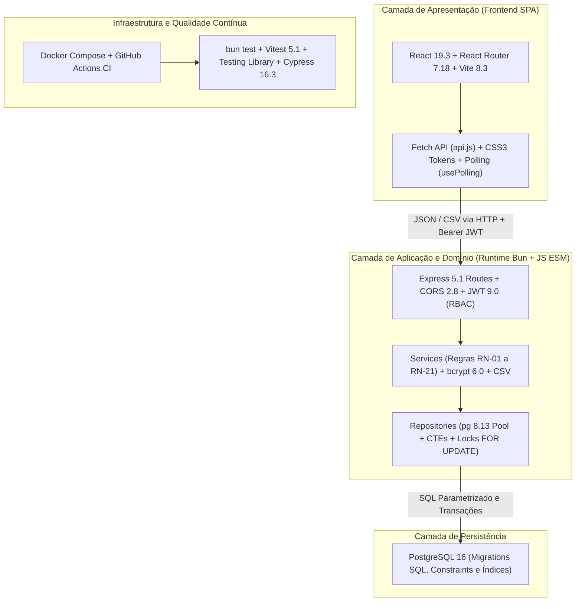
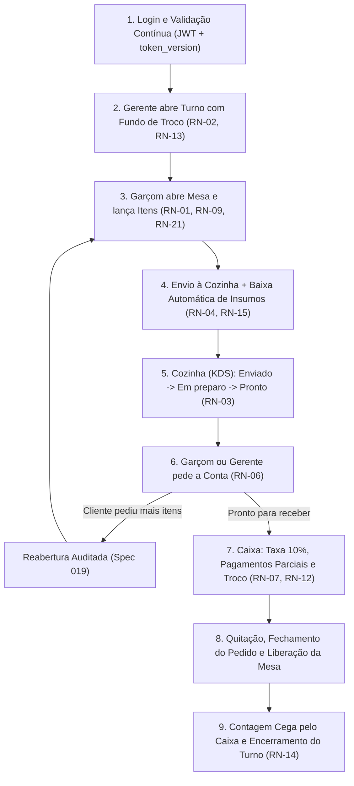
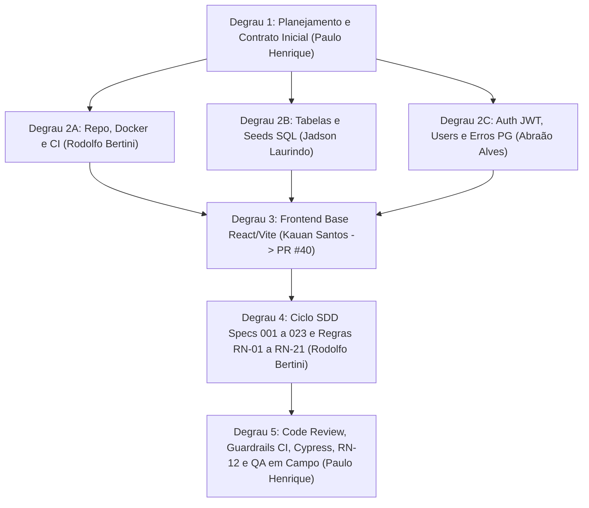

# Engenharia, Arquitetura e Qualidade: MesaFácil

> [!NOTE]
> **Destinatário:** Professor / Avaliador / Leitor Técnico  
> **Repositório:** `GT4Bez/MesaFacil` (Specs `001` a `024`, Regras `RN-01` a `RN-21`)  
> **Stack:** JavaScript ESM (Node.js / Bun / Express 5), PostgreSQL 16 (SQL puro sem ORM) e React 19 / Vite 8

Este documento apresenta uma visão consolidada da arquitetura do **MesaFácil**, explicando como o sistema foi estruturado, como os 5 integrantes da equipe atuaram ao longo do desenvolvimento e de que forma os princípios de engenharia de software (**KISS**, **YAGNI**, **DRY**, **Clean Code** e **SOLID**) foram aplicados na prática.

> [!TIP]
> **Dica de leitura:** clique na seta ao lado de cada seção abaixo para expandir ou recolher os detalhes técnicos. Todos os arquivos citados são links clicáveis para abertura direta.

---

<strong>1. Visão Geral da Arquitetura e Fluxo Operacional</strong>

O MesaFácil é um sistema presencial de PDV e gestão operacional para restaurantes, conectando **Salão**, **Comanda**, **Cozinha (KDS)**, **Caixa**, **Turno**, **Estoque (Insumos)** e **Administração**. A arquitetura prioriza **integridade transacional no banco** e **baixo acoplamento estrutural**, evitando abstrações pesadas desnecessárias.

### 1.1 Arquitetura em Camadas e Tecnologias

O sistema foi desenhado em camadas bem delimitadas sobre [docker-compose.yml](../docker-compose.yml), combinando **React 19 + Vite 8** no cliente ([frontend/package.json](../frontend/package.json)), **Bun + Express 5.1** na API REST ([backend/package.json](../backend/package.json)) e **PostgreSQL 16** com SQL explícito na camada de dados:

| Camada | Tecnologias Utilizadas | Papel na Arquitetura |
| :--- | :--- | :--- |
| **Apresentação (SPA)** | `React 19.3`, `React Router 7.18`, `Vite 8.3`, `CSS3` | Interface responsiva por perfil, rotas protegidas por papel ([RoleRoute.jsx](../frontend/src/components/RoleRoute.jsx)) e polling sem WebSocket. |
| **API e Segurança** | `Bun`, `Express 5.1`, `jsonwebtoken 9.0`, `cors 2.8`, `dotenv 16.4` | Roteamento HTTP, autenticação JWT com checagem de `token_version` no banco e tratamento global de erros. |
| **Regras de Negócio** | `JavaScript ESM puro`, `bcrypt 6.0`, [pgErrors.js](../backend/src/errors/pgErrors.js) | Orquestração transacional das regras `RN-01` a `RN-21`, throttling de senhas, exportação CSV e auditoria. |
| **Banco de Dados** | `PostgreSQL 16` (`postgres:16-alpine`), driver `pg 8.13` (`pg.Pool`) | SQL puro parametrizado, locks pessimistas (`FOR UPDATE`), isolamento `REPEATABLE READ` e constraints parciais. |
| **Qualidade e Infra** | [docker-compose.yml](../docker-compose.yml), [ci.yml](../.github/workflows/ci.yml), `bun test`, `Vitest 5.1`, `Cypress 16.3` | Guardrails de código no CI, testes unitários/integração com Postgres real e testes E2E completos. |

### 1.2 Fluxo Operacional Completo (Ponta a Ponta)

O diagrama abaixo resume o ciclo completo de operação dentro de um turno de trabalho, evidenciando onde atuam cada perfil (`Gerente`, `Garçom`, `Cozinha` e `Caixa`) e as travas transacionais do sistema:

### 1.3 Pilares Arquiteturais Adotados

| Pilar | Decisão no Projeto | Benefício Concreto |
| :--- | :--- | :--- |
| **Stack uniforme** | 100% JavaScript ESM (validado em [ci.yml](../.github/workflows/ci.yml#L16-L46)) | Elimina etapa de build no backend e reduz a curva de entrada para toda a equipe. |
| **Persistência explícita** | SQL parametrizado via `pg.Pool` (sem ORM) | Permite controle direto de `FOR UPDATE`, `FOR SHARE`, `REPEATABLE READ` e CTEs com window functions. |
| **Dupla barreira de integridade** | Regras nos Services + Constraints no PostgreSQL | Índices únicos parciais e `CHECK` garantem invariantes mesmo sob requisições concorrentes. |
| **Tempo real enxuto** | Polling resiliente ([usePolling.js](../frontend/src/hooks/usePolling.js)) | Mantém Salão, Cozinha e Caixa sincronizados com pausa automática em aba oculta, sem WebSocket. |
| **Segurança operacional** | `token_version` no banco + throttle em `auth_throttles` | Revoga sessões instantaneamente (`RN-16`) e bloqueia força bruta no login e autorização (`RN-19`). |

---

<strong>2. Organização da Equipe, Metodologia e Papel de Cada Integrante</strong>

### 2.1 Linha Evolutiva da Equipe (Modelo em Escada)

A evolução do MesaFácil ocorreu em degraus progressivos, combinando base técnica compartilhada e papéis complementares do início do repositório até a entrega final:

### 2.2 Metodologia de Desenvolvimento

* **Fase 1 (Contract-First na Sprint 1):** definição prévia de rotas, payloads e envelope de erro em [SPRINT_1.md](SPRINT_1.md) e [CONTRATO-API.md](../frontend/CONTRATO-API.md), permitindo trabalho paralelo entre Banco (`Jadson`), Backend/Auth (`Abraão`) e Frontend (`Kauan`).
* **Fase 2 (Spec-Driven Development a partir de 18/11):** cada nova funcionalidade nasceu como especificação em [docs/specs/README.md](specs/README.md), gerou issues por área (`[BD/BACKEND]` e `[FRONTEND]`), avançou por PRs curtos com `Closes #N` e passou por CI completo (Guardrails, PostgreSQL real, Vitest e Cypress E2E) antes do merge.

### 2.3 Papel e Entregas de Cada Integrante

| Integrante | GitHub | Papel no Projeto | Principais Entregas e Contribuições |
| :--- | :--- | :--- | :--- |
| **Paulo Henrique** | `@PauloHenrrq` | **Tech Lead, Product Owner, Governança, QA e Code Review** | Organizou o backlog inicial (22 issues por área e plano `RN-01` a `RN-10`), escreveu [SPRINT_1.md](SPRINT_1.md) (contract-first) e reestruturou a documentação de produto ([README.md](../README.md)). Revisou 75 PRs (73 aprovações) e realizou 74 merges, aplicando ajustes de QA diretamente nas branches. Criou o CI de guardrails (`#79`), completou as suítes Vitest/Cypress (`#91`), corrigiu race condition de turno (`RN-02`, `#80`), implementou taxa de serviço, fila anti-overpayment e troco (`RN-12`, `#81`) e conduziu a validação final de stress e RBAC (`#172`, `#173`). |
| **Rodolfo Bertini** | `@rodox83br` | **Infraestrutura / DevOps e Engenharia Full-Stack (SDD)** | Criou o repositório (29/09), o devcontainer (`#8`), o [docker-compose.yml](../docker-compose.yml) (`#41`/`#42`) e o CI com PostgreSQL real (`#60`). Refatorou o frontend base recebido do Kauan (`#40`) e conduziu a maior parte da evolução funcional no fluxo SDD: escreveu as specs em [docs/specs/README.md](specs/README.md), implementou backend e frontend das regras `RN-01` a `RN-21` e produziu [ROTEIRO-DEMO.md](ROTEIRO-DEMO.md), [demo-regras.sh](../scripts/demo-regras.sh) e [ESPECIFICACAO.md](ESPECIFICACAO.md). |
| **Jadson Laurindo** | `@jadsonelorraine` | **Banco de Dados e Modelagem Relacional** | Estruturou as tabelas operacionais centrais no PostgreSQL (`shifts`, `tables`, `menu_items`, `orders`, `order_items` e `payments`), com constraints e seeds iniciais (PRs `#32` a `#37`), além da correção do hash `bcrypt` dos usuários iniciais (`#31`). |
| **Abraão Alves** | `@AbraaoAlvs` | **Backend, Autenticação e Tratamento de Erros** | Criou a tabela e seed inicial de `users` (`#12`), implementou a base de login com JWT e testes (`#38`) e estruturou o CORS e a tradução de erros SQLSTATE do PostgreSQL (`#39`), base aproveitada posteriormente nas mensagens informativas de [021-mensagens-de-erro-informativas.md](specs/021-mensagens-de-erro-informativas.md). |
| **Kauan Santos** | `@kauansantos01` | **Frontend Base (React / Vite)** | Desenvolveu a estrutura inicial da interface em React/Vite (tela de login, salão, comanda e caixa). O código foi enviado ao Rodolfo e publicado no repositório pelo commit inicial de frontend do PR `#40` (25 arquivos), servindo de base para a refatoração de contrato e telas seguintes. |

> [!NOTE]
> **Nota de transparência na atribuição:** a contagem bruta de commits reflete quem publicou o código no Git (o frontend inicial do Kauan entrou via PR `#40` do Rodolfo, e os números do Paulo incluem merges e ajustes de revisão). Por isso, a avaliação dos papéis acima combina commits, PRs, revisões e os registros internos da equipe.

---

<strong>3. Mapeamento Estrutural das Camadas (Backend e Frontend)</strong>

### 3.1 Camadas do Backend (`backend/src/`)

| Camada | Diretório | Módulos Existentes | Responsabilidade Real |
| :--- | :--- | :--- | :--- |
| **Bootstrap** | `backend/src/` | [server.js](../backend/src/server.js) (21), [app.js](../backend/src/app.js) (35) | Subida do servidor, encerramento gracioso, CORS, montagem dos 11 routers e `errorMiddleware`. |
| **Config e Conexão** | `config/`, `database/` | [env.js](../backend/src/config/env.js) (40), [DatabaseConnection.js](../backend/src/database/DatabaseConnection.js) (42) | Validação *fail-fast* de variáveis de ambiente e `pg.Pool` com helper `withTransaction`. |
| **Routes** | `routes/` | [authRoutes.js](../backend/src/routes/authRoutes.js), [orderRoutes.js](../backend/src/routes/orderRoutes.js), [shiftRoutes.js](../backend/src/routes/shiftRoutes.js), [tableRoutes.js](../backend/src/routes/tableRoutes.js), [kitchenRoutes.js](../backend/src/routes/kitchenRoutes.js), [menuItemRoutes.js](../backend/src/routes/menuItemRoutes.js), [ingredientRoutes.js](../backend/src/routes/ingredientRoutes.js), [userRoutes.js](../backend/src/routes/userRoutes.js), [meRoutes.js](../backend/src/routes/meRoutes.js), [auditRoutes.js](../backend/src/routes/auditRoutes.js), [settingsRoutes.js](../backend/src/routes/settingsRoutes.js) | Roteamento REST, middlewares `authenticateToken`/`requireRole` e envelope `{ success: true, data }`. |
| **Controllers** | `controllers/` | [AuthController.js](../backend/src/controllers/AuthController.js) (17) | Mantido apenas em [authRoutes.js](../backend/src/routes/authRoutes.js); os outros 10 routers delegam direto para Services (ou [TableRepository.js](../backend/src/repositories/TableRepository.js)). |
| **Services** | `services/` | [OrderService.js](../backend/src/services/OrderService.js), [IngredientService.js](../backend/src/services/IngredientService.js), [ShiftService.js](../backend/src/services/ShiftService.js), [UserService.js](../backend/src/services/UserService.js), [MenuItemService.js](../backend/src/services/MenuItemService.js), [AuthService.js](../backend/src/services/AuthService.js), [SettingsService.js](../backend/src/services/SettingsService.js), [AuthThrottleService.js](../backend/src/services/AuthThrottleService.js), [AuditQueryService.js](../backend/src/services/AuditQueryService.js), [KitchenService.js](../backend/src/services/KitchenService.js), [AuditLogService.js](../backend/src/services/AuditLogService.js) | Orquestração das regras `RN-01` a `RN-21`, validações de domínio, transações e auditoria. |
| **Repositories** | `repositories/` | [OrderRepository.js](../backend/src/repositories/OrderRepository.js), [StockRepository.js](../backend/src/repositories/StockRepository.js), [ShiftRepository.js](../backend/src/repositories/ShiftRepository.js), [ShiftReportRepository.js](../backend/src/repositories/ShiftReportRepository.js), [CashMovementRepository.js](../backend/src/repositories/CashMovementRepository.js), [ShiftCountRepository.js](../backend/src/repositories/ShiftCountRepository.js), [UserRepository.js](../backend/src/repositories/UserRepository.js), [MenuItemRepository.js](../backend/src/repositories/MenuItemRepository.js), [AuditLogRepository.js](../backend/src/repositories/AuditLogRepository.js), [AuthThrottleRepository.js](../backend/src/repositories/AuthThrottleRepository.js), [SettingsRepository.js](../backend/src/repositories/SettingsRepository.js), [KitchenRepository.js](../backend/src/repositories/KitchenRepository.js), [TableRepository.js](../backend/src/repositories/TableRepository.js) | Queries SQL parametrizadas, CTEs, agregações no banco e locks pessimistas. |
| **Domínio e Auth** | `domain/`, `auth/` | [query.js](../backend/src/domain/query.js) (60), [movementsCsv.js](../backend/src/domain/movementsCsv.js) (57), [labels.js](../backend/src/domain/labels.js) (46), [auditCategories.js](../backend/src/domain/auditCategories.js) (23), [money.js](../backend/src/domain/money.js) (8), [roles.js](../backend/src/auth/roles.js) (7) | Funções puras de parsing, geração segura de CSV, dicionários de mensagens e `hasRole`. |
| **Erros e Segurança** | `errors/`, `middlewares/` | [pgErrors.js](../backend/src/errors/pgErrors.js) (61), [AppError.js](../backend/src/errors/AppError.js) (33), [authMiddleware.js](../backend/src/middlewares/authMiddleware.js) (42), [errorMiddleware.js](../backend/src/middlewares/errorMiddleware.js) (35) | Hierarquia de erros HTTP, tradução de códigos SQLSTATE e verificação contínua de `token_version`. |

### 3.2 Camadas do Frontend (`frontend/src/`)

| Camada | Diretório | Módulos Existentes | Responsabilidade Real |
| :--- | :--- | :--- | :--- |
| **Entrada e Rotas** | `frontend/src/` | [main.jsx](../frontend/src/main.jsx) (16), [App.jsx](../frontend/src/App.jsx) (62) | Montagem React 19, `BrowserRouter`, `AuthProvider` e rotas protegidas por `RoleRoute`. |
| **Sessão e HTTP** | `context/`, `services/` | [AuthContext.jsx](../frontend/src/context/AuthContext.jsx) (66), [api.js](../frontend/src/services/api.js) (90) | Sessão em `localStorage`, sincronização via `/me`, cliente `fetch` e `api.download` (Blob autenticado). |
| **Hooks** | `hooks/` | [useAction.js](../frontend/src/hooks/useAction.js) (24), [usePolling.js](../frontend/src/hooks/usePolling.js) (62) | Padronização de `busy`/`error` em ações assíncronas e polling com `visibilitychange`. |
| **Utils** | `utils/` | [auditLabels.js](../frontend/src/utils/auditLabels.js) (136), [format.js](../frontend/src/utils/format.js) (44), [access.js](../frontend/src/utils/access.js) (33), [dates.js](../frontend/src/utils/dates.js) (15), [reopen.js](../frontend/src/utils/reopen.js) (10) | Matriz RBAC (`SCREENS`), formatadores `pt-BR`, datas ISO e descrições de auditoria. |
| **Componentes** | `components/` | [Modal.jsx](../frontend/src/components/Modal.jsx), [ReasonModal.jsx](../frontend/src/components/ReasonModal.jsx), [AuthorizedCancelModal.jsx](../frontend/src/components/AuthorizedCancelModal.jsx), [IngredientHistoryModal.jsx](../frontend/src/components/IngredientHistoryModal.jsx), [CashMovements.jsx](../frontend/src/components/CashMovements.jsx), [ShiftClosing.jsx](../frontend/src/components/ShiftClosing.jsx), [RecipeModal.jsx](../frontend/src/components/RecipeModal.jsx), [RefreshStatus.jsx](../frontend/src/components/RefreshStatus.jsx), [Toast.jsx](../frontend/src/components/Toast.jsx), [QuantityStepper.jsx](../frontend/src/components/QuantityStepper.jsx), [Layout.jsx](../frontend/src/components/Layout.jsx), [RoleRoute.jsx](../frontend/src/components/RoleRoute.jsx), [StatCard.jsx](../frontend/src/components/StatCard.jsx) | Primitivos reutilizáveis e painéis/modais de domínio (13 arquivos). |
| **Páginas** | `pages/` | [Cashier.jsx](../frontend/src/pages/Cashier.jsx), [Order.jsx](../frontend/src/pages/Order.jsx), [Tables.jsx](../frontend/src/pages/Tables.jsx), [Kitchen.jsx](../frontend/src/pages/Kitchen.jsx), [ShiftAdmin.jsx](../frontend/src/pages/ShiftAdmin.jsx), [Ingredients.jsx](../frontend/src/pages/Ingredients.jsx), [MenuAdmin.jsx](../frontend/src/pages/MenuAdmin.jsx), [Users.jsx](../frontend/src/pages/Users.jsx), [Audit.jsx](../frontend/src/pages/Audit.jsx), [Settings.jsx](../frontend/src/pages/Settings.jsx), [Account.jsx](../frontend/src/pages/Account.jsx), [Login.jsx](../frontend/src/pages/Login.jsx) | 12 páginas operacionais e administrativas + `Presentation.jsx` (Spec 023/024). |
| **Estilização** | `frontend/src/` | [styles.css](../frontend/src/styles.css) (1.943 linhas) | Design tokens em `:root`, layout responsivo e adaptação mobile (`<= 650px`). |

---

<strong>4. Análise Prática: KISS, YAGNI, DRY e Clean Code</strong>

### 4.1 KISS (Keep It Simple, Stupid)
* **Acertos no projeto:**
  * Transações explícitas em 14 linhas ([DatabaseConnection.js](../backend/src/database/DatabaseConnection.js#L23-L36)) e SQL direto em relatórios de CMV, saldo acumulado (`SUM() OVER`) e throttle atômico ([AuthThrottleRepository.js](../backend/src/repositories/AuthThrottleRepository.js#L28-L48)).
  * Modais construídos sobre a tag nativa `<dialog>` ([Modal.jsx](../frontend/src/components/Modal.jsx#L7-L65)), com gestão de foco e `Escape`, sem dependências externas.
  * Polling enxuto ([usePolling.js](../frontend/src/hooks/usePolling.js#L10-L62)) em 62 linhas para atualização automática.
* **Pontos onde há complexidade evitável:**
  * [AuthController.js](../backend/src/controllers/AuthController.js#L3-L17) mantém `try/catch` com `next(error)` e `.bind(this)`, embora o Express 5.1 já propague erros de funções `async` automaticamente.
  * [Cashier.jsx](../frontend/src/pages/Cashier.jsx#L19-L191) (554 linhas) concentra 3 instâncias de `useAction()`, `usePolling()`, `useToast()` e subcomponentes no mesmo arquivo.
  * [styles.css](../frontend/src/styles.css) cresceu para 1.943 linhas com 9 blocos `@media (max-width: 650px)` espalhados ao longo do arquivo.

### 4.2 YAGNI (You Aren't Gonna Need It)
* **Acertos no projeto:** não há `BaseRepository`, `BaseService`, containers de DI, camadas burocráticas de DTOs ou bibliotecas pesadas de estado global. Quase todo o código existente é efetivamente utilizado em produção.
* **Resquícios menores encontrados:**
  * [AuthController.js](../backend/src/controllers/AuthController.js) ficou como padrão isolado apenas no módulo de autenticação.
  * Stub `lockById` em [orderService.test.js](../backend/tests/unit/orderService.test.js#L16), método que não existe no [OrderRepository.js](../backend/src/repositories/OrderRepository.js) real (`findById(id, { lock: true }, db)`).
  * Quatro seletores CSS declarados e reabertos em pontos diferentes de [styles.css](../frontend/src/styles.css) (`.dot`, `.cash-table`, `.hint`, `.modal input`).

### 4.3 DRY (Don't Repeat Yourself)
* **Reuso consolidado com sucesso:** [money.js](../backend/src/domain/money.js), [query.js](../backend/src/domain/query.js) (compartilhado entre Histórico de Insumo e Auditoria), [roles.js](../backend/src/auth/roles.js), [dates.js](../frontend/src/utils/dates.js), [reopen.js](../frontend/src/utils/reopen.js), [Modal.jsx](../frontend/src/components/Modal.jsx), [ReasonModal.jsx](../frontend/src/components/ReasonModal.jsx) e [CashMovements.jsx](../frontend/src/components/CashMovements.jsx).
* **Duplicações reais que ainda valem consolidar:**
  1. Helper `ok(res, data, status)` repetido em 7 routers do backend ([orderRoutes.js](../backend/src/routes/orderRoutes.js#L8), [menuItemRoutes.js](../backend/src/routes/menuItemRoutes.js#L12), [ingredientRoutes.js](../backend/src/routes/ingredientRoutes.js#L8), [userRoutes.js](../backend/src/routes/userRoutes.js#L8), [meRoutes.js](../backend/src/routes/meRoutes.js#L8), [auditRoutes.js](../backend/src/routes/auditRoutes.js#L8), [settingsRoutes.js](../backend/src/routes/settingsRoutes.js#L8)).
  2. Arredondamento `Math.round(value * 100) / 100` redeclarado em [MenuItemService.js](../backend/src/services/MenuItemService.js#L7-L10), [ShiftReportRepository.js](../backend/src/repositories/ShiftReportRepository.js#L179) e [env.js](../backend/src/config/env.js#L34) em vez de importar de [money.js](../backend/src/domain/money.js).
  3. Método `snapshot(callback)` (`REPEATABLE READ READ ONLY`) duplicado entre [ShiftReportRepository.js](../backend/src/repositories/ShiftReportRepository.js#L10-L15) e [StockRepository.js](../backend/src/repositories/StockRepository.js#L38-L43).
  4. Helpers `cleanText`/`cleanReason` idênticos em [ShiftService.js](../backend/src/services/ShiftService.js#L14), [OrderService.js](../backend/src/services/OrderService.js#L50) e [IngredientService.js](../backend/src/services/IngredientService.js#L18).
  5. Formatadores `formatDateTime` e `formatTime` repetidos em 7 arquivos do frontend ([ShiftAdmin.jsx](../frontend/src/pages/ShiftAdmin.jsx#L10), [Audit.jsx](../frontend/src/pages/Audit.jsx#L11-L12), [Settings.jsx](../frontend/src/pages/Settings.jsx#L5-L6), [IngredientHistoryModal.jsx](../frontend/src/components/IngredientHistoryModal.jsx#L27-L28), [RefreshStatus.jsx](../frontend/src/components/RefreshStatus.jsx#L6), [CashMovements.jsx](../frontend/src/components/CashMovements.jsx#L13) e [ShiftClosing.jsx](../frontend/src/components/ShiftClosing.jsx#L7)).

### 4.4 Clean Code
* **Pontos fortes:** nomenclatura consistente (`camelCase` no JS, `snake_case` no SQL), comentários focados no *porquê* (ordem de locks contra deadlocks e prevenção de enumeração de e-mails), tradução padronizada de erros SQLSTATE em [pgErrors.js](../backend/src/errors/pgErrors.js) e identificador `reference` nos erros 500 ([errorMiddleware.js](../backend/src/middlewares/errorMiddleware.js#L27-L34)).
* **Pontos de atenção:** funções extensas como `OrderService.updateStatus` ([OrderService.js](../backend/src/services/OrderService.js#L240-L328), 89 linhas), injeção parcial de dependências em `makeOrderService` ([orderService.test.js](../backend/tests/unit/orderService.test.js#L13-L26)) e nome de campo em inglês (`name`/`category`) em uma mensagem de validação de [MenuItemService.js](../backend/src/services/MenuItemService.js#L20).

---

<strong>5. Princípios SOLID (Separação S - O - L - I - D no Contexto JS ESM)</strong>

Em JavaScript ESM sem interfaces formais, o SOLID manifesta-se por **coesão de módulos, extensão orientada a dados, compatibilidade polimórfica de contratos, assinaturas enxutas e injeção de dependências via construtor**.

### S : Single Responsibility Principle (Responsabilidade Única)
* **Onde foi bem aplicado:** services enxutos como [KitchenService.js](../backend/src/services/KitchenService.js) (20 linhas), [AuditQueryService.js](../backend/src/services/AuditQueryService.js) (46), [AuthThrottleService.js](../backend/src/services/AuthThrottleService.js) (56) e [SettingsService.js](../backend/src/services/SettingsService.js) (74); separação do domínio de turno em 4 repositories especializados ([ShiftRepository.js](../backend/src/repositories/ShiftRepository.js), [ShiftReportRepository.js](../backend/src/repositories/ShiftReportRepository.js), [CashMovementRepository.js](../backend/src/repositories/CashMovementRepository.js), [ShiftCountRepository.js](../backend/src/repositories/ShiftCountRepository.js)); hooks focados no frontend ([useAction.js](../frontend/src/hooks/useAction.js), [usePolling.js](../frontend/src/hooks/usePolling.js), [Toast.jsx](../frontend/src/components/Toast.jsx)).
* **Pontos de sobrecarga identificados:**
  * [OrderService.js](../backend/src/services/OrderService.js) (534 linhas) concentra 6 responsabilidades: abertura de mesa/pedido, gestão de itens e limite de lançamento, preparo KDS, cancelamentos autorizados, reabertura de conta e faturamento/pagamentos.
  * [IngredientService.js](../backend/src/services/IngredientService.js) (282) e [StockRepository.js](../backend/src/repositories/StockRepository.js) (258) misturam controle de estoque/histórico/CSV com gestão de fichas técnicas (`recipe`).
  * [Cashier.jsx](../frontend/src/pages/Cashier.jsx) (554) e [Order.jsx](../frontend/src/pages/Order.jsx) (452) reúnem múltiplos subcomponentes e painéis no mesmo arquivo.

### O : Open/Closed Principle (Aberto/Fechado)
* **Onde foi bem aplicado (extensível sem alterar lógica central):**
  * `DEFINITIONS` em [SettingsService.js](../backend/src/services/SettingsService.js#L6-L20): novas configurações entram por mapa declarativo sem modificar `get()` ou `update()`.
  * `AUDIT_CATEGORIES` ([auditCategories.js](../backend/src/domain/auditCategories.js#L3-L23)) e `DESCRIBERS` ([auditLabels.js](../frontend/src/utils/auditLabels.js#L32-L136)), com fallback seguro na UI e teste automático de cobertura contra o `CHECK` do banco ([auditLogs.test.js](../backend/tests/integration/auditLogs.test.js)).
  * `UNIQUE_MESSAGES` em [pgErrors.js](../backend/src/errors/pgErrors.js#L12-L19) e matriz `SCREENS` em [access.js](../frontend/src/utils/access.js#L6-L33).
* **Onde novas regras exigem múltiplas alterações:** adicionar uma nova ação de auditoria envolve atualizar migration SQL (`CHECK`), [auditCategories.js](../backend/src/domain/auditCategories.js), `toTarget` em [AuditLogRepository.js](../backend/src/repositories/AuditLogRepository.js) (se houver nova entidade) e [auditLabels.js](../frontend/src/utils/auditLabels.js).

### L : Liskov Substitution Principle (Substituição de Liskov)
* **Hierarquia [AppError.js](../backend/src/errors/AppError.js#L1-L33):** todas as 7 subclasses (`BadRequestError`, `UnauthorizedError`, `ForbiddenError`, `NotFoundError`, `ConflictError`, `DomainValidationError`, `TooManyAttemptsError`) preservam integralmente o contrato de `AppError`/`Error` e são processadas de forma polimórfica pelo [errorMiddleware.js](../backend/src/middlewares/errorMiddleware.js).
* **Substituição de conexão (`DatabaseConnection` vs `pg.PoolClient`):** ambos implementam `.query(text, params)`, permitindo que métodos de repositories operem transparentemente com ou sem transação ativa ([DatabaseConnection.js](../backend/src/database/DatabaseConnection.js)).
* **Composição acima de herança:** evitar `BaseRepository` impediu violações de LSP em repositories somente leitura ([TableRepository.js](../backend/src/repositories/TableRepository.js), [KitchenRepository.js](../backend/src/repositories/KitchenRepository.js), [ShiftReportRepository.js](../backend/src/repositories/ShiftReportRepository.js), [AuditLogRepository.js](../backend/src/repositories/AuditLogRepository.js)); no frontend, [ReasonModal.jsx](../frontend/src/components/ReasonModal.jsx) e [AuthorizedCancelModal.jsx](../frontend/src/components/AuthorizedCancelModal.jsx) compõem [Modal.jsx](../frontend/src/components/Modal.jsx) mantendo o contrato de fechamento assíncrono.

### I : Interface Segregation Principle (Segregação de Interfaces)
* **Onde foi bem aplicado:** hooks com retorno mínimo e repositories de turno divididos por caso de uso.
* **Contratos inflados encontrados:**
  * Construtores posicionais longos em [ShiftService.js](../backend/src/services/ShiftService.js#L18-L26) (7 parâmetros) e [OrderService.js](../backend/src/services/OrderService.js#L54-L61) (6 parâmetros).
  * Componente `Bill` em [Cashier.jsx](../frontend/src/pages/Cashier.jsx#L370) recebe 9 props distintas.
  * [OrderService.js](../backend/src/services/OrderService.js) depende de [StockRepository.js](../backend/src/repositories/StockRepository.js) apenas para `recordSales`, mas recebe uma classe com 12 métodos (incluindo histórico, CSV e ficha técnica).

### D : Dependency Inversion Principle (Inversão de Dependência)
* **Onde foi bem aplicado:** os 11 services e 13 repositories utilizam **injeção de dependência via parâmetros padrão no construtor** (`constructor(repo = new Repo())`), viabilizando dublês em testes unitários e validação real de rollback transacional (`failingAudit` em [audit.test.js](../backend/tests/integration/audit.test.js#L176-L177)) sem frameworks externos.
* **Acoplamentos diretos remanescentes:**
  * [authMiddleware.js](../backend/src/middlewares/authMiddleware.js#L8) instancia `const userRepository = new UserRepository()` no topo do módulo, impedindo testar unitariamente sem banco o caminho completo de token válido + `token_version` ([authMiddleware.test.js](../backend/tests/unit/authMiddleware.test.js)).
  * [AuthService.js](../backend/src/services/AuthService.js) e [UserService.js](../backend/src/services/UserService.js) importam `bcrypt` e `jwt` diretamente, e os componentes React consomem o singleton `api` de [api.js](../frontend/src/services/api.js) (decisões pragmáticas adequadas ao porte do projeto).

---

<strong>6. Validação em Campo, Posicionamento e Próximos Passos</strong>

> [!IMPORTANT]
> **Posicionamento Técnico:** O MesaFácil apresenta uma arquitetura **madura, enxuta e bem defendida contra falhas operacionais e de concorrência**. Na auditoria em campo contra o ambiente ativo (`http://localhost:3001` e `http://localhost:5173`), foram executadas **336 checagens empíricas de RBAC** (48 endpoints × 7 perfis), **14 baterias paralelas de stress/concorrência** e **11 sondas de borda**, sem nenhum erro `500` nem vazamento de dados sensíveis (`password_hash`, `expectedCash` ou logs restritos). Os dois desvios pontuais encontrados (ordem da checagem de papel em `OrderService.updateItemStatus` e modo leitura na Comanda para o perfil `cashier`) foram corrigidos e abertos nos PRs `#172` e `#173`.

### O que Melhorar (Refatorações Pragmáticas de Alto Retorno)

| Prioridade | Ação Sugerida | Onde Aplicar | Benefício |
| :---: | :--- | :--- | :--- |
| **P1** | Adotar objeto de dependências nos construtores longos e corrigir `makeOrderService` | [OrderService.js](../backend/src/services/OrderService.js), [ShiftService.js](../backend/src/services/ShiftService.js), [IngredientService.js](../backend/src/services/IngredientService.js), [orderService.test.js](../backend/tests/unit/orderService.test.js) | Evita injeções parciais acidentais em testes e remove o stub órfão `lockById`. |
| **P1** | Extrair cálculos puros de faturamento para `domain/billing.js` | [OrderService.js](../backend/src/services/OrderService.js#L445-L483) | Reduz o tamanho do `OrderService` e libera testes unitários puros de subtotal, taxa e troco. |
| **P1** | Centralizar `snapshot()` em `DatabaseConnection.withSnapshot()` | [DatabaseConnection.js](../backend/src/database/DatabaseConnection.js), [ShiftReportRepository.js](../backend/src/repositories/ShiftReportRepository.js), [StockRepository.js](../backend/src/repositories/StockRepository.js) | Elimina duplicação da transação `REPEATABLE READ READ ONLY`. |
| **P2** | Limpezas simples de DRY e consistência no backend | [MenuItemService.js](../backend/src/services/MenuItemService.js), [AuthController.js](../backend/src/controllers/AuthController.js), [UserRepository.js](../backend/src/repositories/UserRepository.js), [MenuItemRepository.js](../backend/src/repositories/MenuItemRepository.js) | Reusar [money.js](../backend/src/domain/money.js), centralizar `ok()`, remover `AuthController.js` e aplicar whitelist nos `UPDATE` dinâmicos. |
| **P2** | Fatiar subcomponentes e centralizar formatadores de data no frontend | [Cashier.jsx](../frontend/src/pages/Cashier.jsx), [Order.jsx](../frontend/src/pages/Order.jsx), [dates.js](../frontend/src/utils/dates.js) | Melhora legibilidade e isola estado da gaveta em relação ao extrato. |
| **P3** | Organizar CSS por domínio via `@import` nativo e atualizar documentação | [styles.css](../frontend/src/styles.css), [ARQUITETURA.md](ARQUITETURA.md) | Remove seletores duplicados e alinha a documentação oficial às specs recentes. |

### O que NÃO Mexer (Para Preservar KISS e YAGNI)
1. **Não introduzir ORM (Prisma, Drizzle ou Sequelize):** o SQL explícito com `FOR UPDATE`, `FOR SHARE`, CTEs e `REPEATABLE READ` é o maior diferencial de confiabilidade transacional do sistema.
2. **Não criar `BaseRepository` ou herança de Services:** a composição direta evita acoplamento rígido e violações de LSP.
3. **Não criar `Controllers` nos outros 10 routers:** no Express 5, o caminho mais limpo é remover o único controller restante ([AuthController.js](../backend/src/controllers/AuthController.js)).
4. **Não adotar TypeScript, DI Container, Redux/Zustand, React Query ou WebSockets:** o conjunto atual entrega todas as 21 regras de negócio com simplicidade e manutenção direta.

